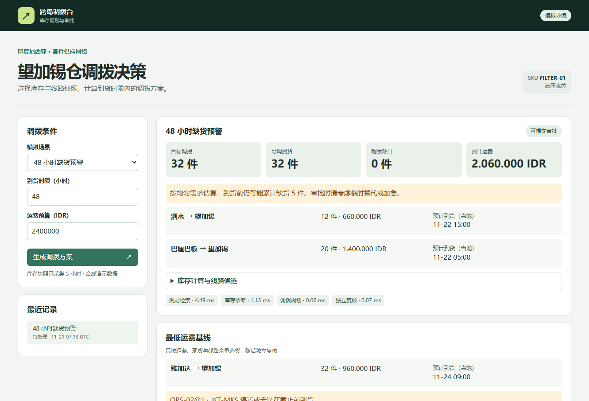
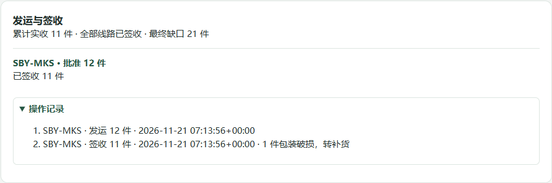
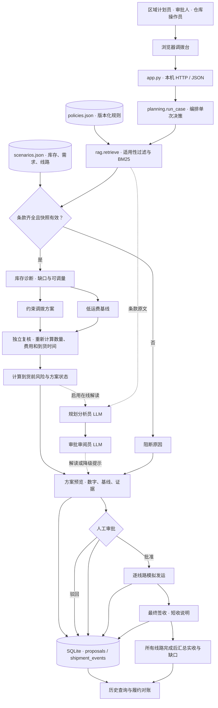

# 跨岛备件调拨 Agent

望加锡仓的液压滤芯快用完了。区域计划员要回答三个问题：**48 小时内从哪里调、调多少、到货之后还差多少？** 这个项目把库存预测、规则检索、线路分配、人工审批和仓库签收接在同一张调拨单上。读者可以从一次缺货预警开始，一直操作到最后一件货的签收对账。

业务场景取自印尼跨岛仓储中的库存与运输权衡。仓名用于说明地理关系，库存、需求、报价和规则均为合成数据。每张调拨单都是对固定快照的一次独立模拟。



## 快速演示

需要 **Python 3.9+**。默认模式使用 Python 标准库和浏览器，克隆后可离线运行。

```shell
git clone https://github.com/YKk154/inventory-transfer-agent.git
cd inventory-transfer-agent
python -X utf8 demo.py
```

这条命令在随机本机端口启动应用，通过真实 HTTP 接口跑三个情景，读回审批和签收历史，然后清理临时数据库。可核对以下输出。

```text
正常班次 | 目标 32 件 | 预计运费 2,060,000 IDR
  SBY-MKS | 12 件 | 30 小时
  BPN-MKS | 20 件 | 20 小时
到货前预计最大缺货 5 件
线路停运 | 可调 12 件 | 计划缺口 20 件
签收对账 | 计划发 12 件 | 实收 11 件 | 最终缺口 21 件
```

### 用浏览器亲手跑一单

在项目根目录运行 `python app.py`，保持终端打开，再访问 [本地调拨台](http://127.0.0.1:8077)。端口占用时可运行 `python app.py --port 8088`，访问相应端口。

| 操作 | 可以验证的业务结果 |
| --- | --- |
| 选择「48 小时缺货预警」，保留 48 小时和 2,400,000 IDR，生成方案 | 泗水 12 件、巴厘巴板 20 件。展开库存与线路候选，核对每个仓能拿出多少货 |
| 查看「最低运费基线」与「决策依据」 | 雅加达 32 件只要 960,000 IDR，但需 72 小时，且本仓只可调 19 件。复核会列出触犯的两条制度 |
| 切换「航线临时停运」，重新生成 | 巴厘巴板线路关闭。方案可发 12 件，余下 20 件需要安排其他货源 |
| 输入「余下 20 件另行补货」，点击批准，再登记泗水线路发运 | 该线路从待发运转为在途，发运量锁定为批准的 12 件 |
| 最终实收填 11，说明填「1 件包装破损，转补货」，登记签收 | 已签收 11 件。全部线路完成后显示最终缺口 21 件，操作记录保留短收说明 |
| 刷新页面，从「最近记录」重新打开方案；另试「库存快照过期」 | 可以读回原方案的审批与签收记录。新选的过期案例会在规划前被阻断 |



## 业务链与需求

| 谁在何时做决定 | 所需信息与实现 | 交付给下一步 |
| --- | --- | --- |
| 区域计划员收到缺货预警 | 输入收货时限和运费预算，系统读取同一快照下的四仓现货、预留、近七天需求和三条线路 | 一次带决策时点的规划请求 |
| 计划员核对可用制度 | 按仓区、生效日、失效日筛选五类规则，每类取一条适用证据。检查库存快照年龄 | 带版本的原文和策略参数，或明确的阻断原因 |
| 调出仓保护本地订单 | 库存诊断计算收货仓缺口，同时从各调出仓扣除预留、预计需求和安全库存 | 目标调拨量、各仓可调上限 |
| 计划员比较备选线路 | 在预算、班次、容量、库存和时限内分配件数，同时计算低运费基线；复核器按原始线路重算，再评估到货前的缺货风险 | 逐条线路的件数、费用、预计到货时间和违规证据 |
| 审批人决定是否接受方案 | 查看明细与条款，可批准或驳回。部分覆盖需要给出后续处理说明 | SQLite 保存方案快照和审批决定，只有获批线路进入履约 |
| 调出仓发货，收货仓点收 | 每条线路登记一次整批发运和一次最终签收。实收可低于发运量，短收须说明 | 收货件数和事件记录。所有线路终结后按目标减实收汇总最终缺口 |

## 系统架构



默认路径由 Python 函数显式编排。开启 `--live` 后，**规划分析员**读取已检索条款、件数、运费与途中风险，**审批审阅员**再读取同一份证据和分析员解读。两次模型调用只产生文字说明，网络或模型故障会返回降级提示。批准、发运和签收均由人操作，Python 负责执行状态约束。

## 望加锡为什么需要 32 件

| 默认快照的计算 | 数值 |
| --- | --- |
| 望加锡可用量 = 现货 − 已预留 | 16 − 4 = **12 件** |
| 截止前预计需求 = 近七天日均 × 48/24，向上取整 | 20 × 2 = **40 件** |
| 安全库存 = ceil(z × 日需求样本标准差 × √提前期天数) | 当前规则 z = 1.65，提前期 2 天，取整后 **4 件** |
| 目标调拨量 = max(0, 预计需求 + 安全库存 − 可用量) | 40 + 4 − 12 = **32 件** |

同样的库存保护也适用于调出仓。泗水可用 38 件，扣除本地预计需求 24 件和安全库存 2 件后，可调 12 件。它的单价为 55,000 IDR，余下 20 件由巴厘巴板按每件 70,000 IDR 补齐，合计 **2,060,000 IDR**。在单品、单收货仓、直达、单价固定的设定下，先用便宜的可行运力，可以在预算内先最大化覆盖件数，再最小化该覆盖量的运费。

这里有三个值得独立查看的数。

- **计划缺口**等于目标减按时可调件数。默认案例为 0。
- **到货前缺货**按均匀需求逐个到货时点估算。第一批 20 小时到达，到货前累计需求约 17 件，当时只有 12 件，峰值缺货为 5 件。
- **最终缺口**等于目标减实际登记的签收件数。停运案例计划缺口为 20，若再短收 1 件，最终缺口就是 21。它衡量相对本次目标的差额。

## 技术栈与代码入口

| 环节 | 技术与实现位置 | 为什么这样实现 |
| --- | --- | --- |
| Web 与接口 | HTML、CSS、原生 JavaScript、Fetch，Python `ThreadingHTTPServer`。[界面](static/ui.js) · [HTTP 服务](app.py) | 本机单进程跑通交互，前端无需构建 |
| 规则检索与 RAG | 中文二元切词、BM25、规则元数据。[检索器](rag.py) · [规则库](data/policies.json) | 有效期和适用仓决定条款能否引用。同一规则类别内依次比较仓区特异性、生效日期、BM25 相关度，再以 ID 打破平局。保护系数和快照时效直接从命中条款取值 |
| 库存与调拨 | Python `statistics`、整数分配、独立复核。[规划逻辑](planning.py) · [输入快照](data/scenarios.json) | 数量、运费、到货时点可重算，可与同一快照下的低价基线逐项比较 |
| 可选模型解读 | DeepSeek Chat Completions、Python `urllib`。[模型适配](model.py) | 取回的证据进入生成上下文。只开启离线模式时，界面直接展示原始规则和计算结果 |
| 持久化与履约 | SQLite、审批条件更新、写事务、线路事件唯一键。[履约逻辑](fulfillment.py) | 拦截越序、重复和并发重复登记，按原审批快照重建线路状态 |
| 验证 | `unittest`、`unittest.mock`、临时数据库及真实本机 HTTP。[回归测试](tests/test_end_to_end.py) · [可执行演示](demo.py) | 可复现正向流程、数据过期、停运、部分批准、短收、重复操作和模型故障 |

**当前 RAG 的作用**是找到本次决策可引用的规则版本，并把它同时交给程序和可选模型。演示库共 7 条，含 1 条过期版本和 1 条其他仓区的规则。默认案例有 5 条适用规则，仓区和日期承担主要筛选作用。时限、线路容量和审批条件由 Python 实现，新增业务规则需要同步调整执行代码。

### 接口与运行选项

| 接口 | 输入与返回 |
| --- | --- |
| `GET /api/scenarios` | 返回可选模拟场景、默认时限和预算 |
| `POST /api/plan` | 输入 `scenario`、`deadline_hours`、`budget`，返回方案 ID、证据、明细及审批状态 |
| `POST /api/decision` | 输入 `id`、`decision`（`approved` 或 `rejected`）、`note`；部分批准须留说明 |
| `POST /api/fulfillment` | 输入 `id`、`lane_id`、`action`（`dispatch` 或 `receive`）。签收还需 `quantity`，短收还需 `note` |
| `GET /api/history` | 返回最近 20 张方案的快照、审批和线路事件，可在重启后查看 |

运行 `python -B -m unittest discover -s tests -v` 可复现回归测试。运行 `python app.py --db my-demo.sqlite3` 可指定本地记录库。默认监听回环地址，`Ctrl+C` 停止服务。

使用模型时，在当前终端或 IDE 的运行环境中配置 `DEEPSEEK_API_KEY`，执行 `python app.py --live`。默认模型为 `deepseek-flash`，可用 `DEEPSEEK_MODEL` 覆盖。在线模式把本单模拟输入生成的方案和规则原文发送给 DeepSeek。仓库内的演示和测试均可离线完成，模型异常路径使用 mock 验证。[DeepSeek 接口文档](https://api-docs.deepseek.com/)

## 数据与适用范围

快照的决策时点固定为 **2026-11-21 09:00（UTC+8）**，方案到货时间按这个时点推算。发运与签收记录保存操作时的 UTC 时间，用于回放登记顺序。签收数量是用户输入，案例间独立，系统不会向物流商下单或把一次模拟的库存扣减带入下一单。

当前覆盖单 SKU、一个收货仓、一次整批发运和一次最终签收。真实使用还需要对接库存台账与物流状态、处理多单库存预占和分批收货，并用历史样本验证需求预测误差。演示数值用于复核程序行为。

领域与学习参考：[InvAgent](https://github.com/zefang-liu/InvAgent)、[Inventra](https://github.com/Balaastratech/Inventra)、[Datawhale Hello Agents](https://github.com/datawhalechina/hello-agents)、[The Fresh Connection 供应链模拟](https://inchainge.com/business-games/tfc/)。
